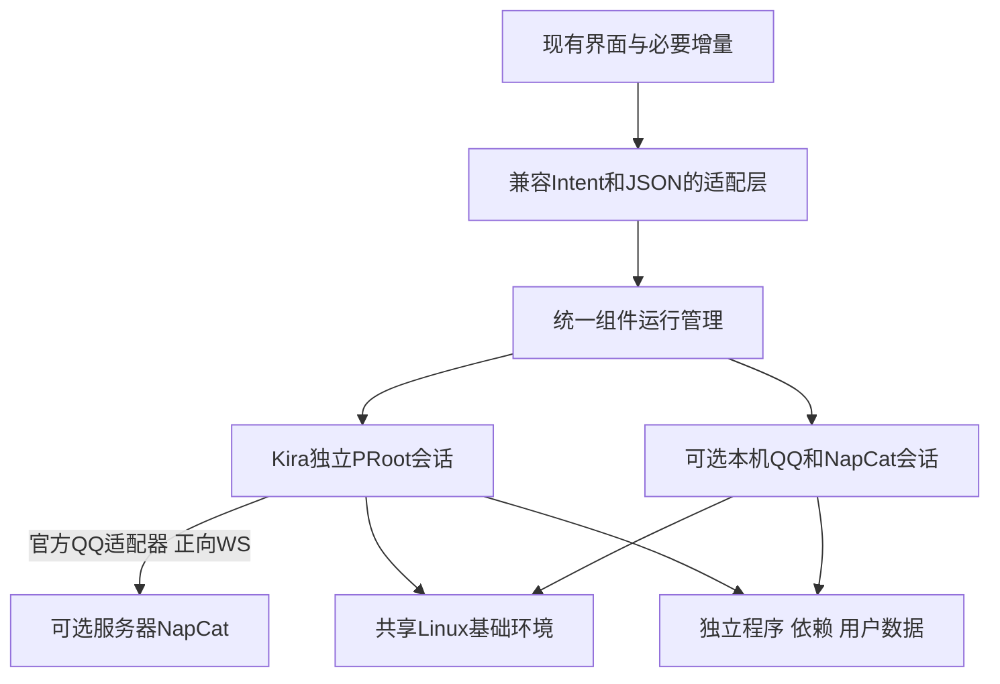

# Kira Android宿主综合执行计划

- 版本：v4；编制日期：2026-11-10（Asia/Shanghai）。
- 状态：供人工确认的执行基线。本次合并计划，不开始业务修复、安装或发布。
- 范围：`android-kira-host`的宿主、构建、运行包、数据、维护及发行流程。
- 参考候选：宿主0.6.3/code16，Kira首装种子v3.1.2、NapCat首装基线v4.18.42。实施前重新绑定实际输入。
- v3合并v2、完整架构评估和代码审查，替代v2的执行顺序。v2原文已按摘要保留在[审查快照](.runtime/reviews/20261110-plan-v2/PLAN_REVIEWED_V2.md)。
- 完整审查、逐项行号与安全复现见[审查报告](.runtime/reviews/20261110-plan-v2/AUDIT.md)。本计划中的“关闭”均指未来满足验收，不代表已修复。
- v4按本轮明确要求补充：进一步降低存储占用、本机NapCat可选、手机Kira连接服务器NapCat；保留v3全部问题及停止/人工验收规则，首轮R0A范围不扩大。v3原文保留于[扩展前快照](.runtime/reviews/20261110-storage-remote/PLAN_BEFORE_STORAGE_V3.md)。本轮结论与源码证据见[存储及远程连接评估](.runtime/reviews/20261110-storage-remote/ASSESSMENT.md)。

## 1. 不变目标与改动边界

1. 手机免Root，Kira始终在手机运行；保留无需外部运行服务器的本机QQ/NapCat模式，同时增加“仅Kira”和“连接服务器NapCat”模式。本机NapCat不再强制安装；远程模式依赖服务器提供QQ桥接。维持单一Android应用，无需另装Termux。
2. 不修改Kira、NapCat上游源码或官方requirements，不替换官方业务模块、supervisor或安装器来实现兼容。正常官方更新和插件安装保留。
3. 优先跟随官方更新和现有插件；不承诺依赖Docker、systemd、特权内核功能或特殊GPU的任意桌面插件都能运行。
4. UI允许在现有状态区、菜单或工具弹窗中增加必要信息和入口，保持整体布局、视觉风格、三入口导航和主要流程，不整体重做。
5. 模型仍可使用用户配置的API；本地宿主部署不等于本地大模型推理。全离线首装不作为已确认的硬要求。
6. 不擅自读取/输出账号密钥，不迁移、删除或改写现用用户数据，不连接现用手机、登录QQ、请求模型、覆盖安装或发布。涉及这些操作时走对应人工门禁。
7. 当前只制定计划。后续执行先取得本计划及首个增量范围的确认；一次确认不等于自动实施全部路线。

关于既有WebView下载/展示适配：当前Blob钩子和样式适配没有改写官方发布文件，但与旧计划“禁止注入/monkey patch”的宽泛措辞有歧义。P08保留为人工裁决项；触及这些适配前明确边界，不擅自删除功能或扩大修改上游业务的范围。该未决项不阻塞不相关的R0A。

## 2. 架构选择：改什么、为什么、收益与代价

主线：**先稳定宿主管理契约，再交付可复现的PRoot/glibc Linux运行环境；原版Kira在手机运行，QQ/NapCat按需本机安装或连接已有服务器。**

ARM64手机运行ARM64 Linux程序时，PRoot主要转译路径及部分系统调用，不模拟CPU。预构建环境改善安装/维护，不自动消除QQ/Electron的常驻成本或Android后台限制。

| 改造 | 原因与收益 | 成本/限制 | 实施位置 |
| --- | --- | --- | --- |
| 异常释放与候选校验 | 写失败后能重试；缺关键库的坏包被拒绝 | 较小；不改变UI/上游/数据路径 | R0A |
| 代次认领与最终化交接 | 旧事件不误停新进程，旧轮不清新轮资源 | 中；Android资源效果需集成验证 | R0B |
| 持续健康事实 | 识别进程活着但面板不可达，纠正过期状态 | 中；首轮不自动重启，不冒充QQ/模型健康 | R1 |
| 本机NapCat可选与远程连接 | 跳过整套QQ程序、专属依赖及数据增长；复用官方QQ适配器连接服务器 | 低到中；要贯通默认选择、启动全部、命令和恢复，不只改开关 | R1C/R1D |
| 环境/程序/venv/数据分层 | 换基础环境不重新seed或遗漏QQ数据；分别恢复 | 高；路径读写者、链接语义和ABI迁移必须验证 | R2 |
| 预构建依赖/运行包 | 降低首装联网解析、编译和网络失败面 | 中到高；包可能更大，更新仍允许新依赖 | R3 |
| 控制、恢复、通知解耦 | 降低状态交接复杂度，减少无效刷新及人工重启 | 中；不绕过Doze/OEM，不争抢官方内部重启 | R4 |
| 取消、备份、恢复与空间管理 | 取消真正结束任务，保护有效备份，避免满盘 | 中到高；按独立闭环分批交付 | R5 |
| Node组合与可选原生宿主 | 研究包体、依赖和维护面精简 | 中/高；按净收益决策，不强制换语言 | R6 |
| 支持矩阵与发行闭环 | 保持签名覆盖，明确兼容、更新和运行证据 | 测试投入为主，不能用静态检查替代真机 | R7 |

不采用为主线：Kira原生Android化、重写Kira核心、重做Termux发行版、改Alpine/musl、Docker/AVF普适替代、QEMU全系统性能优化。它们会增加上游契约适配、权限或资源成本，与当前兼容优先目标不匹配。

现有静态包体事实：独立Node约29.5MiB，基础归档约26.8MiB，Android Python/Chaquopy相关约12.1MiB，Kira种子约8.7MiB。以下分开报告APK、下载、安装后常驻和安装峰值，不能将同一份归档重复相加成净收益，也不将存储收益写成内存/耗电/速度收益。

### 2.1 三种运行用法与默认行为

| 用法 | 手机安装/运行 | QQ桥接来源 | 边界 |
| --- | --- | --- | --- |
| 仅Kira | 共享Linux基础、原版Kira及兼容依赖 | 无；可用官方WebUI及其他已配置适配器 | 不请求本机NapCat安装/更新，不把QQ未配置视为Kira故障 |
| 本机NapCat | 在上述基础上按需安装QQ、NapCat及专属系统库 | 手机本机 | 保留原有独立运行能力、官方安装更新及本机loopback绑定 |
| 远程NapCat | 与“仅Kira”相同的手机基础；官方QQ适配器主动连接 | 用户已有服务器上的QQ/NapCat | 不安装本机桥接，不负责在服务器安装/更新/停止NapCat；断网会影响QQ消息 |

新安装默认启动Kira，本机NapCat默认不安装；需要时在现有组件控制/菜单明确选择并安装。旧安装保留已保存选择及原有程序/QQ数据；旧偏好缺字段时按版本迁移规则保留既有使用行为，不拿“新安装默认值”覆盖升级用户。

分别记录安装事实、用户的组件选择、运行意图和实际运行事实。全局停止只停止运行，不清除用户保存的组件组合；无选择时明确保持停止，不能兜底启用所有组件。仅取消勾选、改为远程或停止组件都不等于卸载。显式本机NapCat启动可以引导安装；“启动全部”指当前选择的本机组件，不能重新勾选并安装全部可用组件。远程NapCat不是宿主可停止的本机进程。

三行表示常见用法，不新增一套互斥配置去改写Kira适配器。用户已有多个QQ适配器或同时使用本机/远程时保留官方配置能力；宿主的本机NapCat选择只控制本机安装和运行。

### 2.2 存储优化优先级、收益及代价

| 优先级/方案 | 改什么与为什么 | 可核算收益 | 风险/验收与轮次 |
| --- | --- | --- | --- |
| 1：不装本机QQ/NapCat | Kira-only/remote跳过NapCat ensure、QQ下载和Xvfb/GTK等专属依赖；共享运行包不夹带整套本机QQ | 当前ARM64基线少下载QQ 207,538,924字节、NapCat zip 35,967,555字节，合计约232.23MiB；另避免解包程序、专属库、安装副本及后续QQ数据。解包净节省待实测 | 主要减少下载、安装占用与峰值；当前APK没有内置这两个安装归档，不能据此声称APK缩小232MiB。R1C、R3B |
| 2：减少APK内置归档的私有副本 | 基础/Node完成验证安装后按身份回收可重新从当前APK取得的副本；启动先检查已完成安装再决定导入 | 当前ARM64基础28,137,951字节+Node30,968,168字节，私有缓存约56.37MiB；种子9,233,148字节约8.81MiB另行核验消费链后决定 | 先改Java导入和Python消费者契约；否则删后每次重导入。APK内置压缩资源和解包后的运行文件仍存在。R5C2 |
| 3：收敛安装暂存和下载缓存 | 成功后清理无引用attempt副本/part；下载缓存按摘要共享，保留少量必要的离线恢复资产 | 当前NapCat将已下载QQ.deb和Shell再复制到attempt；单次副本可接近232MiB，是否含QQ取决于needs_qq；当前无统一保留上限 | 不改官方安装器；首步在安装退出并完整校验后删除安全副本，活动/待恢复/未知attempt保留。R5C2 |
| 4：日志、包管理缓存与备份治理 | 区分APT归档/索引、pip下载缓存、npm缓存与实际已安装依赖/MCP工作目录；各自限额和回收 | 长期收益依实际数据测量；不预填“省几GB” | npm的_npx或包目录可能正被MCP使用；官方更新进程也可能占用缓存。维护窗口、引用和任务归属明确后处理。R5C3/R5B |
| 5：可选Node轻量组合 | 标准兼容组合保留Node；明确不用Node工具的用户可选轻量包，保留补装 | Node当前APK构成约29.5MiB，另有解包目录及缓存；净值以重建APK和实际安装为准 | 禁用本机NapCat不会自动让Kira的Node MCP/插件不需要Node；QQ内置运行时也不是这个独立Node。R6A |
| 6：系统包裁剪/移除Android Python | 先测目录及依赖成本，再决定文档/locale等可再生资产或开发工具组合；原生宿主管理仅做收益原型 | 尚无可靠净值；不能把Chaquopy的12.1MiB直接当净节省 | 不删官方依赖、不按静态import裁第三方包、不删pip/包元数据/证书；标准组合先保留官方更新和源码插件构建能力。R3B/R6B |

首轮空间工作优先“避免安装”和“消除无用副本”，之后处理长期增长。存量用户仅切换模式不会自动得到已安装QQ的空间收益；独立的显式卸载闭环后续交付。保留QQ数据时需如实显示它仍占空间，不能为节省空间自动注销或删登录数据。

空间报告固定四个口径：①APK实际字节；②干净安装联网下载字节；③安装结束后实际分配占用，按程序/依赖/数据/缓存/备份分类；④安装/更新最高占用及所需额外空闲。扫描只读、不跟随越界链接、可取消，不把扫描本身做成每500ms的常驻全盘遍历。

峰值预检按宿主可控制的本次事务计算：新增下载、必要scratch、展开staging、备份和安全余量；下载的.part与原子改名后的完整归档是同一份字节，已有可用缓存只算新增差额，按阶段可能同时存在的最大集合估算，不能机械相加。旧运行目录已计入当前占用，不重复计费。不同卷分别检查，跨卷复制另计；空间未知则不开始破坏性提交。迁移期保留旧环境会暂时更大，不能用提前删旧环境来达到体积指标。官方Kira面板内部更新/插件安装不能在零改源码下冒称已被宿主强制预检。

### 2.3 手机Kira连接服务器NapCat的可行性

结论：**官方协议与当前v3.1.2实现支持跨机器配置，不需要修改Kira/NapCat源码；当前未完成手机到真实服务器的业务验收。** [Kira官方QQ配置](https://docs.kira-ai.top/zh/configuration/adapter/qq.html)要求配置NapCat的WebSocket服务器并将连接信息填入QQ适配器；[NapCat网络配置](https://napneko.github.io/config/basic)区分正向WS与管理面板。

- Kira官方`schema.json`已有`ws_uri`和`ws_token`；客户端将地址传给`websockets.connect`，Token使用`Authorization: Bearer`，没有强制127.0.0.1。地址填`wss://bot.example.com/onebot`或可达私网的`ws://地址:端口`，Token填独立字段。这里的地址是示例，不是已配置服务。
- NapCat在服务器启用正向WebSocket服务器；手机主动连出，无需手机公网IP或反向端口。常见3001是示例端口，6099是NapCat管理面板，WebUI Token与OneBot Token用途不同；不把管理页URL填作QQ连接地址。
- 公网采用有可信证书的WSS入口和非空OneBot Token；私网WS仅限可信网络。TLS可由服务器代理终止后转发到本机NapCat；不放宽本机NapCat绑定或Android WebView域名白名单。[websockets官方文档](https://websockets.readthedocs.io/en/stable/reference/asyncio/client.html)说明WSS默认创建TLS上下文；仍须在实际Linux guest验证DNS、CA、主机名和代理路径，不用关闭证书验证处理连接失败。
- 连接配置优先留在官方Kira适配器面板，不另存第二份Token；本机NapCat的`configure_local`只管理本机NapCat，不能覆盖远程QQ适配器。宿主只显示可证明的事实，不抓取Token或用它做额外常驻探活。
- 当前Kira发送图片使用URL或base64、语音使用base64，文件/视频使用URL或base64；接收普通文件取直链、语音取`get_record`的base64。这避免了部分跨机器本地路径问题，但URL可达性、NapCat版本及响应字段、base64内存/帧大小仍需验收。不能把这次核验描述成“远程全部媒体已通过”。
- [NapCat文件指南](https://napneko.github.io/develop/file)另有Stream API；当前Kira客户端没有据此自动变成流式传输。需要改上游源码或新增透明OneBot代理才能解决的问题，按6.2停下提请人工；不把大文件代理加进最短交付。

远程最短交付先验证正确/错误Token、账号身份、白名单文字收发、断线及重连、手机Kira健康与远端桥接故障区分。图片/语音/视频/文件作为下一独立验收片；要收缩为“文字可用”必须明确批准，不能静默宣称QQ完全兼容。

## 3. 证据基线与状态定义

2026-11-10审查绑定53个源/构建/资源/测试文件、10,270行，源码与当时v2计划未被审查修改。

- Python宿主测试75项：70通过、5平台跳过；Java更新检查7项通过。
- C类复现使用临时文件、真实函数、受控线程或真实Java方法提取；Android资源/包验证使用替身的证明层级已在报告标明，不能冒充真机实测。
- code16 APK静态检查曾通过，566个上游源文件字节一致、13个原生库通过现有16KiB对齐检查；C04证明该检查本身仍有漏检。
- code16 APK：84,039,737字节；SHA256为`a03c03fb76d9e55d8bcd01b4ff8556a77ea8eb3a096456af3a0597df80e17210`。
- 历史真机运行证据来自code13；code16完整运行、QQ模型闭环、迁移、长锁屏和多设备验收仍未通过。HTTP429独立作为外部服务问题记录。

下表全部初始状态为“未关闭”。实施后逐项记录：待实施、实现待验收、验收通过、明确保留/暂缓。故障复现通过不等于修复通过；本地逻辑通过、候选绑定、Android运行通过也不能互相替代。

## 4. 全部问题与风险台账

台账共36个索引项：保留原有31项（14项历史问题/改进/验收债务、8项审查新缺陷及1项既有恢复缺口细化、8项计划风险），新增5项存储/部署扩展项N01—N05。**不是36个独立bug**；重叠项保留来源、共享关闭证据，不重复计算工作量。N项包括新需求和兼容风险，不伪装成新复现缺陷。

### 4.1 历史I01—I14

| ID | 类型与问题 | 阶段 | 关闭条件 |
| --- | --- | --- | --- |
| I01 | 已复现：首次ready后不持续观测 | R1 | 健康失效、过期、恢复及所有相关展示/入口符合分层策略 |
| I02 | 条件缺陷：换rootfs重新seed，QQ数据不迁入 | R2 | 先阻止无迁移切换，再验证程序版本与数据迁移、中断恢复 |
| I03 | 管理缺口：运行意图与异常恢复不足 | R0B/R4 | 代次隔离、用户停止优先、有界恢复及清理失败恢复路径 |
| I04 | 可复现性债务：首装APT/pip在线解析 | R3 | 固定基线可复现，仍兼容官方更新与插件依赖 |
| I05 | 历史/平台：休眠冻结、后台限制 | R1/R4/R7 | 能检测/恢复，目标设备锁屏验证；不承诺绕过系统 |
| I06 | 业务验收债务：自动回复未通过，历史429 | R7 | QQ收信、OneBot、名单、模型、发送分别通过或明确外部失败 |
| I07 | 恢复缺口：备份已校验但恢复闭环不足 | R5B | 已验证归档安全恢复并启动，失败保留且有用户入口 |
| I08 | 空间治理不足：日志/缓存/尝试/备份增长 | R5C | 预检、配额、轮转、可审查清理，不删未知数据 |
| I09 | 兼容验收债务：Android/内核/ABI/16KiB矩阵 | R7 | 声明支持范围并实际运行；跳过不算通过 |
| I10 | 性能待测：500ms无变化通知/状态读取 | R4B | 控制与通知分离，比较CPU/操作延迟，不凭感觉判收益 |
| I11 | 架构成本：Android Python与默认Node | R6 | 兼容不回退且净收益有数据，或明确保留/暂缓 |
| I12 | 发布待办：候选code16、在线清单仍code10 | R7 | 只在验收后同步真实产物、发布并验证发现/安装 |
| I13 | 发布契约：当前调试构建和既有签名链 | R7 | 同签名覆盖或经明确批准的迁移策略，不擅自换钥 |
| I14 | 架构边界：PRoot无网络隔离 | R4/R7 | 保留认证，具备证据时核验端点；未知不冒充隔离 |

### 4.2 新审查C01—C09

| ID | 严重度/证据与问题 | 修复轮次 | 最少关闭证据 |
| --- | --- | --- | --- |
| C01 | P1，真实Python故障复现：状态I/O失败泄漏运行锁 | R0A | 最终快照/锁后目录创建失败后锁释放，可再次进入启动；真实归属安全阻断不被清除 |
| C02 | P2，真实函数受控交错：旧monitor按名称误停新record | R0B | PID/run_id替换后旧事件无权停止新代次；不只在调用前检查一次 |
| C03 | P1，真实Java方法探针：新轮先begin，旧finalizer清新轮资源 | R0B | 逻辑交接验证、候选绑定、Android前台通知/唤醒锁归属集成证据分别通过 |
| C04 | P2，负向APK：缺libpython甚至全部原生库仍通过检查 | R0A | 合法所选ABI包通过；缺解释器/全缺库被拒；预期按构建ABI和宿主模式驱动 |
| C05 | P2，真实控制流探针：包验证期间取消仍发布APK/提示安装 | R5A | 验证中和UI排队时取消不迟到提交；提交点语义明确 |
| C06 | P2，受控文档流：本地导入阻塞后取消不释放worker | R5A | 阻塞提供者取消有可验证资源策略，后续操作不永久堵塞 |
| C07 | P2，本机慢流：read(n)持续收数据时取消无总期限 | R5A；R1自有请求另保证 | 持续慢流中也能有界取消，不能把socket空闲超时当总期限 |
| C08 | P2，条件性真实tar复现：内容损坏但stat不变，删好留坏 | R5B | 不能让内容不匹配的备份占名额并删除有效归档；发现不一致保留并警告 |
| C09 | P2，既有缺口细化：unsafe_stop后无重试停止/核验解锁入口 | R4A | 管理器/进程存在与健康分离；可重试清理，证明旧归属全退出后人工解除，未知继续阻断 |

C08必须保留“大小、mtime、inode均不变”的条件，不泛化为普通写入必漏检，也不当同UID隔离漏洞。C09完整UI链路适用于根error且无其他active组件；有其他ready组件时不泛化。C03不是已完成Android资源实测。

### 4.3 计划风险P01—P08

| ID | 风险 | 落实位置与必要验收 |
| --- | --- | --- |
| P01 | 仅加health文字，导航/按钮/重载/读屏仍只看ready | R1：定义每个消费者策略；生命周期停止权限不能随health一起禁用 |
| P02 | 健康请求无总期限、在途槽卡死；启动版本查询仍在锁内 | R0B/R1：网络不持生命周期锁，慢流/迟到/槽回收/控制响应组合验收 |
| P03 | guest bind不改变宿主Path物理读取 | R2A：统一host/guest解析，版本、配置、备份、安装和依赖摘要都命中新路径 |
| P04 | rootfs解包器改变独立venv的绝对符号链接 | R3A：按包类型定义链接语义，在guest实际执行venv解释器 |
| P05 | 官方更新暂时不可达被外层恢复误杀 | R4A：官方内部更新/重启与外层退出分开，无法可靠判定时不自动杀进程 |
| P06 | 可保存归档不等于可安全恢复；失效哈希任务仍占worker | R5B：链接/特殊对象/暂存恢复，关闭/重复刷新与后续任务不堵塞 |
| P07 | Node仍被清单、导入、启动与校验当作必需 | R6A：能力化全链路，无Node基础包与补装都实际运行；保留QQ内置运行时 |
| P08 | 上游零修改措辞与既有WebView适配歧义 | 触及下载/展示适配前人工裁决；不擅删Blob导出，不擅改上游业务 |

### 4.4 本轮扩展N01—N05

| ID | 现状/扩展风险 | 落实位置与关闭条件 |
| --- | --- | --- |
| N01 | 默认双组件、总启动和Service兜底仍强制选择本机NapCat；只改一个勾选值会被绕过 | R1C：新装仅Kira，全部启动/恢复/维护入口遵守选择；显式安装闭环与旧偏好升级通过 |
| N02 | APK内置资源、私有下载副本及解包目录同时存在；直接删缓存会重导入 | R5C1/R5C2：可核算前后占用，连续启动不重导入，损坏修复/离线/取消安全 |
| N03 | NapCat attempt/全量备份、包缓存和待安装APK增加长期/峰值占用；不安全清理可能损坏更新恢复 | R5B/R5C：所有权、引用、配额及空间预检通过；C08未修复前不依赖自动备份淘汰保护数据 |
| N04 | 远程协议可行不代表媒体、大文件或直接访问本机QQ目录的插件都兼容 | R1D1文字与身份/重连；R1D2代表媒体和失败边界；R7标明远程支持范围，未测不算通过 |
| N05 | 本机运行状态与远程适配器状态混淆；失败时可能补装/误重启本机组件或误改远程配置 | R1C/R1D/R4：远程不是本机进程，不受本机启停/更新命令管理；配置留官方，未知状态不冒充就绪 |

## 5. 目标职责与目录契约

- 宿主管外层组件、运行意图、归属、任务和维护；Kira官方supervisor管内部更新重启，NapCat按官方方式安装/更新。
- 本机NapCat缺席是合法安装组合。Linux共享基础不捆绑QQ专属依赖；远程连接复用原版Kira适配器，宿主不新增透明协议代理或第二套QQ客户端。
- 保留run_id、同UID及代次验证、重新挂接子进程、guest优先停止和unsafe_stop失败锁存；不得仅用Process.destroy替代。
- 先稳定现有Java/Python边界。全面Binder切换或移除Chaquopy都不是前置条件。
- 候选目录职责：`runtime/base/<generation>`、`apps/kira`、`apps/qq-napcat`、`envs/kira/<generation>`、`data/kira`、`data/qq`、`extensions/node/<version>`、`state`、`cache`、`backups`。
- guest保持`/opt/KiraAI`、`/opt/KiraAI/venv`、`/var/lib/kira`、`/root/Napcat`、`/root/.config/QQ`等已验证路径；P03要求所有宿主读取者同步适配，不能只增加bind。
- Python ABI、glibc、原生wheel、系统库、shebang和路径共同决定venv是否重建。预装基线不意味着官方更新后依赖永久锁定。
- 基础环境由宿主管理是维护边界，不是真正只读挂载或网络/权限隔离。

## 6. 执行规则、停止线和人工裁决

### 6.1 分轮与验收原则

- 当前只交付v4计划；确认后首轮仅执行R0和R0A。完成最少验收后交人工，等待下一轮指示，不自动进入R0B或后续重构。
- 每轮入口冻结范围、排除项、输入身份、验收和证据层级。常规实现细节、原范围内正常修复不反复询问。
- 最少验收是选一个短而完整的交付对象，不是删除直接相关的完整性、取消、归属、数据或兼容检查。
- 本地逻辑、APK绑定、Android运行、真实业务分层记录；不能用构建机或纯Java替身替代目标环境后直接判全部通过。
- 未改源码且输入身份相同时，可复用可追溯的同会话基线；改变相关代码后执行适当回归，不机械重复全套测试。

### 6.2 计划变化必须先问人工

架构、轮次依赖、范围、支持平台/ABI、数据路径、上游契约、整体UI、阈值或验收标准需要改变时：

1. 停止依赖该变化的实现，保留当前成果、失败日志与恢复点，不做危险清理。
2. 审查原计划假设是否错误，给出真实证据及继续原方案的代价。
3. 提交具体修订/收缩建议：改哪些项、最短交付是什么、失去哪些能力、怎样验收和以后怎样扩展。
4. **先问人工；未同意前不改执行基线，也不按新方案继续。** 不先改后报。
5. 人工同意后修订计划与输入身份；本轮完成验收再交人工，不自动扩展下一轮。

改变测试预期、删失败用例、放宽阈值或把Android验收改成构建侧原型都属于计划变化。

### 6.3 回归很多时暂停审计划

任一条件触发暂停：

- 同轮出现3项独立根因的新增功能回归；同一根因造成多个断言失败只计一项。
- 同一缺陷连续2轮实质修复后仍不收敛；不把未改代码的重复运行冒充新修复轮。
- 任一新增数据损坏、误停/误杀其他组件、进程归属、上游更新兼容或签名覆盖破坏，立即暂停，不等累计三项。

区分基线已有缺陷、预期负向用例、本轮新增回归、平台跳过与外部网络/API问题。已知C类复现原本失败不是本轮新增回归；也不能把新失败随意归为外部原因。

暂停后先做计划逻辑审查：若假设/范围/契约有问题，按6.2人工裁决；若仅是原计划内的明确实现错误，可说明证据后在原范围修复，不重置累计计数。不能在缺陷集中时继续堆实现。

### 6.4 成本高时收缩需求，先交最短闭环

若本轮必须引入明确排除的子系统、重写大量不相关逻辑、等待不可用的目标环境，或无法在已定最少验收内给出证据，停止做成本复核。

提出收缩方案并等待人工。**收缩候选不自动生效，也不能自动降低验收标准。** 按事实交付已完成部分和未验收部分，保留剩余台账，等下轮逐步扩展。不为完成进度改上游源码或突破整体UI边界。

### 6.5 人工与发布门禁

- 初次：确认v4及R0A后才实施。
- 每个最短增量：交付候选/原型和证据，人工验收后再批准下一轮。
- 任何计划变化：实施前人工裁决；修订实现结束后再验收。
- 真实设备、账号、数据迁移、覆盖安装、正式发布：对应轮明确授权后才做。
- 自测通过不等于人工通过；文档、复现或勾选完成不等于代码已修复。

## 7. 详细轮次、改动范围和最少验收

### R0：冻结首个增量基线

交付：源码/构建/候选身份、已有工作区改动清单、基线回归和复现索引。

- [ ] 核对宿主、上游种子、运行包、构建ABI与工具链；不读取用户账号配置。
- [ ] 记录既有C01/C04负向行为；同身份的本轮审查证据可复用。
- [ ] 保存现有Python回归基线，跳过和已知问题独立列出。
- [ ] 固定R0A的文件职责、候选绑定方法和验收命令。

不把完整耗电、多设备、长锁屏或UI改造作为首轮前置。

### R0A：第一交付——异常后可重试，坏包被拒绝

**只修C01和C04。** 这是首个最短可验收闭环，不先增加health、自动恢复、数据迁移或新UI。

预计范围：`runtime/host_runtime.py`、`verify_apk.py`、对应测试和必要的构建身份清单。保持启动参数、上游源码、数据路径、签名策略和界面不变。

- [ ] C01：覆盖锁获取后到最终退出的异常释放；状态发布失败不能跳过解锁。
- [ ] 不为解锁清空真实进程归属或unsafe_stop；尚有未解决清理时仍正确阻止新运行。
- [ ] C04：预期ABI来自本次构建选择，必需库来自可信构建输入/版本化宿主模式；不从待验APK反推完整性。
- [ ] 当前ARM64/Chaquopy模式必需库完整；未来R6模式另行定义，不能只硬编码13，也不要求ARM64包包含manifest中所有ABI。

最少验收：

1. 状态落盘失败、锁后目录准备失败后锁不泄漏；无遗留进程时可重试，有真实归属阻断时不得误放行。
2. 原合法ARM64包通过；临时副本删除解释器库、删除全部原生库均被拒；不修改原APK，不用签名检查代替逐库检查。
3. 针对性用例通过后完整宿主回归一次；与本轮无关且未变的Java/UI套件不机械重复。
4. 构建一个ARM64候选，绑定受影响宿主模块、构建输入和校验器；检查上游/requirements、UI资源和签名连续性未被本轮改动。

交付：候选APK、源码/模块绑定、负向检查与回归结果、遗留项。这里只证明本地逻辑和候选打包，不声称ARM64手机完整运行通过。**交人工验收后停止；不发布稳定版，不自动进入R0B。**

若实现必须重写整体运行管理或改变包模式，按6.2停下；不能顺手合并后续任务。

### R0B：第二交付——代次和最终化交接

范围：C02/C03及必要运行契约，保留现有UI与外部控制接口。

- [ ] 停止前原子认领预期record/run_id/代次，旧退出事件无权停止替换后的进程。
- [ ] 旧worker完整清理后才交接新轮；共享资源按代次拥有或使用明确最终化屏障。
- [ ] 不用简单Process.destroy替代现有子进程归属/清理；不引入自动恢复。

最少验收：受控旧record→重启→新record交错；旧finalizer→新begin交接；清理失败仍阻止并发启动；一次相关宿主回归及候选绑定。

C03另需至少一个隔离Android运行环境观察通知/前台服务与CPU唤醒锁的两代交接。纯Java探针只算逻辑证据。无法取得环境时停止请人工决定缩为原型，不能标C03全部关闭。ARM64/其他系统未测范围明确保留。

R0B人工验收先于R1异步健康任务和后续自动恢复。

### R1：健康观测闭环

目标：识别“进程还在、面板不可达”，解除异常后恢复；不自动重启。

- [ ] 保持生命周期`state/ready`契约，新增独立health及探测时间、新鲜度；未知、可达、不可达、过期分开。
- [ ] 默认稳定期10秒探测、单请求总期限1秒、连续3次失败标异常、连续2次成功恢复，30秒无新成功事实则过期；首次未满足门槛保持未知。
- [ ] 采用包含休眠时长的单调时间基准，跨进程/重启不能可靠比较时标未知；不依赖墙钟。
- [ ] 每组件最多一个在途任务，任务有总期限及槽回收；不把socket空闲超时当总期限。
- [ ] 网络不持生命周期锁；同时处理现存启动版本查询的锁内网络路径，不拖慢停止或替代进程退出监控。
- [ ] 启动沿用原有就绪/超时；停止、维护、身份变化后拒绝迟到结果。
- [ ] 定义导航、徽标、读屏、面板按钮和自动重载的health策略；生命周期停止入口不能因health坏而禁用。
- [ ] UI只在现有状态区/相关组件显示必要事实，整体风格和主流程保持；不冒充QQ、OneBot或模型健康。

最少验收：可控时间/本机端点覆盖未知→失败门槛→恢复门槛→过期；慢流和慢版本查询不阻塞控制、槽能回收；旧代次/停止后结果被拒；异常时导航/刷新/读屏与停止入口一致；宿主总回归一次、候选绑定，以及一个隔离Android连续观察路径。

不触发真实QQ/模型。I01按观测范围关闭，I03自动恢复和八小时在线仍未完成。人工验收后再扩展。

### R1C：本机NapCat可选安装——优先交付的空间收益

依赖R0B交接契约及R1状态区分；不依赖R2全量迁移或R3完整运行包。只打通安装组合与控制链，不卸载旧数据、不改变Node默认组合，不新增远程凭据表单。

- [ ] 新安装默认Kira；既有偏好和缺字段的旧安装分别迁移，保留既有QQ数据，不把升级当新装。
- [ ] MainActivity默认值/总启动、HostService默认命令/初始组件集合、Python run默认集合/command(all)和当前保存选择使用同一契约，旧入口也不能绕过；R4后续新增运行意图/恢复模型继续遵守本契约，不成为R1C前置。
- [ ] Kira-only/remote不调用本机NapCat ensure、依赖安装、下载、配置或自动更新；未安装的“更新”不能暗中安装。明确选择“安装本机NapCat”后才进入现有官方安装链。
- [ ] installed、selected、running及安装中/失败独立；取消选择不等于卸载。NapCat未安装/启动失败不把已正常运行的Kira标成整体不可用。
- [ ] 复用现有组件勾选/控制及菜单，必要时加安装/远程说明和未安装状态，整体布局/三入口不变；远程配置入口指向官方Kira面板。

最少验收：

1. 干净Kira-only准备中断言未请求QQ/NapCat归档、未执行NapCat专属APT/安装器；实际隔离Android上Kira面板可用，无宿主管理的本机QQ/NapCat进程及6099监听。
2. 新装启动、停止再启动、“启动全部”、Service重建及旧all命令均不隐式补装；全局停止不抹掉保存组合，无选择不回退到双组件，保存选择后重启仍一致。
3. 明确选择安装本机NapCat后走固定摘要的官方安装链并出现本机组件状态；在授权隔离环境验证本机面板，不要求本轮登录QQ/调用模型。取消/失败不清Kira数据、不误停其运行。
4. 旧版升级fixture分别覆盖已有NapCat、明确禁用、全局手动停止、旧偏好缺字段，保留原偏好和安装数据；单独绑定一个实际候选及针对性回归。真实旧数据覆盖仍按人工门禁执行。

交付后人工验收并停止。本轮只减少新安装的下载/展开成本；已安装QQ的卸载回收留R5C4，APK净缩减不作为本轮承诺。缺目标环境或安装链成本超范围时按6.2提出原型收缩，不能只改默认值就关闭N01。

### R1D1：远程NapCat最短连接验收

依赖R1C；复用官方Kira QQ适配器配置，先交“文字收发与连接故障边界”这一明确范围。服务器由用户提供，当前只写验收方案，不访问现用服务。

- [ ] 官方面板填写ws_uri、ws_token、QQ号及允许对象；宿主不复制Token，不将Token拼入会记录的URL，不开放本机面板到公网。
- [ ] 受控OneBot端点验证正向连接和Bearer；实际guest验证WSS证书/DNS/主机名；错误Token、错QQ号、端口不通不冒充QQ就绪。
- [ ] 远程不显示为本机NapCat正在运行；本机停止/更新/重启与“启动全部”均不发送远端管理动作。无上游可靠接口时显示“远程状态请在官方面板查看”，不新增侵入式常驻探活。
- [ ] 复用上游适配器退避重连；按官方日志/面板确认耗尽并提供固定处置说明，无可靠上游状态接口时原生宿主只显示未知和面板入口，不预先承诺自动感知。不得因此重启整个Kira或自动装本机NapCat；网络切换/用户停止期间不重放旧业务操作。

最少验收：受控认证/错账号/失败路径和一个授权真实远端账号，白名单内一组双向合成文字、不在名单内拒收、断线后重连、错误Token拒绝；Kira面板持续可用且手机没有本机QQ/NapCat安装。记录真实版本、手机/guest身份、远程配置的脱敏摘要；新增宿主日志和交付证据不保存Token/真实聊天原文，不承诺重写上游全部日志。

没有真实端点时只交受控协议原型，按6.2等待人工决定，不关闭真实业务项。R1D1通过仍不关闭媒体/插件兼容，也不等于I06模型自动回复已通过。

### R1D2：远程媒体及插件兼容小轮

R1D1人工验收后，每次入口只绑定一种媒体及直接失败边界：小图片、语音、普通文件、视频分别交付、分别人工验收。各片验证该媒体双向传输；确认URL对真正读取它的一端可达，所调用API返回所需字段。只有全部片通过才声明该媒体集合支持，不把四类媒体/全部插件/峰值性能捆成一个最短交付。

- [ ] 验证手机localhost URL对服务器不可达、过期直链、缺base64、超时/大消息失败不被标记成功；普通媒体通过不代表大文件通过。
- [ ] 记录base64全量编码内存和消息尺寸；客户端16MiB入站限制不是统一出站文件上限，默认动作响应等待10秒也不是整个上传全过程的总期限。
- [ ] 插件兼容另在R7绑定代表项验收，不成为每个媒体小片前置。区分纯OneBot调用与直接读取QQ目录；后者可标注需本机模式，不承诺自动兼容远程。

大文件Stream API或透明协议代理不在本轮。遇到上游缺口先停下提交兼容限制及候选方案；优先等官方能力或选用本机模式，不私改上游代码。要将本轮媒体范围缩小，先按6.2人工决定。

### R2A：路径契约、保护和迁移预检

- [ ] 统一host物理路径与guest路径解析，覆盖source/requirements、NapCat安装/版本/配置/备份/校验及Java关联读取者。
- [ ] 没有已验收迁移路径时，阻止已有安装静默切换新base并保留原环境。
- [ ] 固化目录身份、现有版本、数据位置、空间需求和依赖环境重建条件，输出不含密钥正文的预检。

最少验收：仅加bind不能被当成完成；所有活跃读取者命中新路径；无迁移换base被拒且旧数据不变；预检失败无正式切换。

### R2B：程序、venv与数据迁移

依赖R2A。先在隔离fixture实现，不对现用安装自动启用。

- [ ] 停相关组件、形成可验证备份，复制到暂存区，保留旧环境；程序/数据迁移与venv重建分开。
- [ ] 逐项校验版本、配置、聊天、插件和QQ数据；不覆盖官方已经更新的程序。
- [ ] 对准备、复制、验证、切换、完成记录设计幂等事务及中断续接。
- [ ] 回退考虑迁移后的写入和数据格式变化，不能任意切回旧目录。

最少验收：正常迁移、复制中断、切换前取消、再次执行；程序版本和数据保留、解释器可运行、旧环境未删。真实数据迁移另经人工批准及验收。

### R3A：基线依赖包原型

新安装隔离原型可与R2并行；向已有安装切换新base必须晚于R2B验收。

- [ ] 选定一个官方Kira版本、Python ABI、CPU ABI和基础环境，构建完整传递依赖与摘要；上游源码/requirements不改。
- [ ] 按rootfs、wheel、独立venv等包类型定义链接语义，不能直接复用rootfs绝对链接改写规则。
- [ ] 保留pip、证书、shell及后续官方更新/插件安装，不把基线约束永久强加给上游更新。

最少验收：匹配guest禁止依赖下载后安装、`pip check`、关键原生模块导入、实际执行venv解释器并启动原版Kira到健康端点；身份错配/损坏不冒充成功。构建机通过只交构建侧原型，Android未验证不宣称手机版能力完成。

### R3B：系统依赖和完整运行包交付

- [ ] 按R1C组合交付共享Kira基础和可选本机QQ/NapCat扩展，不能在“完整包”中重新把QQ、Xvfb/GTK等装入所有用户的基础环境；绑定构建输入、版本、大小、摘要及可信发布身份。
- [ ] 维持官方更新与代表性插件兼容；不能通过删包管理/编译能力后承诺任意插件。
- [ ] 校验、受限暂存解包、取消、中断恢复和发布完成记录分开。
- [ ] 区分APK内置导入与远程续传缓存，减少重复归档；不能取消完整校验，清缓存不能导致每次重新导入。

最少验收在本轮入口绑定一个ABI和版本组合：干净准备、坏包拒绝、取消续接、上游更新及代表性插件；报告安装耗时/网络/占用对比，完整包可能更大。多机、业务与长锁屏留R7，不把原型当正式交付。

### R4A：运行意图、有界恢复与unsafe_stop恢复

- [ ] 统一每组件持久运行意图、任务身份及慢任务交接；用户停止优先。
- [ ] 基于R0B/R1事实区分外层进程退出、面板异常与系统回收，恢复有退避、上限和失败锁存。
- [ ] 不误杀官方更新或supervisor内部重启；没有可靠更新事实时保留观测/人工边界，不私加上游钩子。
- [ ] C09提供重试清理和人工核验解除；只有证明旧归属全退出后才能解除，未知继续阻断，不能要求清空所有数据。

最少验收：主动停止不复活，一个组件失败不影响另一组件，恢复限次，旧代次无权操作新轮，清理失败不重启，核验解锁正确，官方内部更新/重启不被争抢。真实常在线不在本轮保证。

### R4B：控制、状态和通知刷新解耦

- [ ] 命令入队直接触发排空，通知/进度各有节流策略，不调慢共享定时器来牺牲操作响应。
- [ ] 先保留Intent/JSON，合并重复读取及快照失效；全面Binder迁移须另有收益证据。

最少验收：停止响应不回退、状态无变化时减少通知/读取；比较可取得的CPU/延迟指标，不据此直接承诺整机耗电收益。

### R5A：取消与I/O提交边界

范围C05/C06/C07，按“验证提交”“本地提供者”“在线慢流”三个闭环分次交付，不同时重写整个下载器。

- [ ] 定义取消被接受和文件发布的提交点，身份验证后及排队UI回调均核验任务代次。
- [ ] 本地输入流/描述符有明确归属和可验证取消策略；不可中断提供者不能永久占住全部维护工作。
- [ ] 在线下载在持续慢流下也有总期限/取消路径；保留已验证缓存与明确失败状态。

每个闭环最少验收：复用对应受控复现验证修复、取消后能再次操作、失败不冒充成功；相关原有回归一次，不访问真实云盘或下载真实发行APK。不得以“取消后不显示UI”替代任务和资源实际结束。

### R5B：备份完整性与安全恢复

- [ ] C08在会删除其他备份的保留决策前取得足够内容完整性证明；损坏归档不挤占有效名额，未知归档保留并警告。
- [ ] 恢复到受限暂存区，核验路径、链接及特殊对象语义，兼容数据格式，保留恢复前数据。
- [ ] 旧列表/哈希任务失效后能停止或让出工作，不只丢弃UI回调。
- [ ] 在现有菜单/工具弹窗增加必要恢复入口，不重排整体UI；触及WebView适配前先裁决P08。
- [ ] 官方面板更新仍由官方负责，不声称宿主已无侵入地拦截所有更新并强制先备份。

最少验收：同stat内容损坏不删好留坏；越界/合法链接分别处理；一份合成完整备份恢复后在隔离配置启动；取消/损坏/满盘不发布成功；关闭/重复刷新不堵塞后续任务；新增入口关键路径人工观察。

### R5C：空间治理——四个小轮分别交付

每个小轮单独人工验收，不一次重写安装、缓存、备份和卸载；R5C1/2不必等待R2全量迁移，但不得绕过当前路径/所有权检查。

**R5C1：占用基线与事务空间预检。** 按2.2四个口径记录相同ABI、版本、设备/文件系统和数据量的前后结果；备份单列，逻辑字节与实际分配占用分开。对宿主可控制的安装/更新/迁移估算本次额外空间，保留安全余量并报告估算依据；不做后台高频全盘扫描，不冒称已拦截官方面板内部更新/插件安装。

最少验收：Kira-only和本机NapCat各一份同口径报告；模拟空间不足、未知容量、不同卷、取消，不进入破坏性提交；UI只在已有维护/状态位置增加可读信息。不能把空间预检放在删旧数据之后。

**R5C2：先回收明确多余副本。** 改RuntimeAssets与Python消费链为按安装/修复需求导入资源；每次实际导入仍完整SHA校验和原子发布。完成记录绑定归档身份、ABI及固定基础/Node所需关键文件与运行探针，不要求每次hash可变整棵rootfs；正常APT、官方Kira更新不能被误判为原始快照损坏。APK可再导入的base/Node归档、已成功attempt的安装副本、无引用part分别回收；seed先核对源码/前端/工具wheel等消费者。已解包运行文件不作为缓存删除。

最少验收：连续三次启动不重导入被回收归档；清理后离线启动；关键文件缺失/身份不匹配时从APK校验重导入或明确进入修复，已正常更新的Kira不被重新seed/覆盖，不原地重解包覆盖含Kira/QQ数据的现有rootfs，破坏性修复/换base仍受R2迁移门禁约束；取消/满盘不发布完整标记；运行/待恢复attempt、链接与越界目录拒删。报告实际净回收及修复峰值。暂不改官方安装器从源头取消scratch复制，先删除已安全结束的多余副本。

**R5C3：长期增长、配额与保留。** 日志轮转、下载缓存、已结束attempt、APT/pip/npm可重建缓存、panel备份、待安装APK各有独立归属、引用和保留规则。在本轮入口绑定配额、保留数量/时长和低空间策略，人工确认后才执行；不把全盘“缓存”一律删掉。安装/官方更新/插件/MCP活动时不删其依赖的缓存或包目录；无法证明空闲则延期。QQ/Kira数据与插件不参加自动淘汰。

备份淘汰依赖R5B完整性/恢复通过；至少保留满足本轮保护规则的可用恢复点，不为了满足配额删掉最后一份有效备份。未解决pending、失败安装证据、未知归档只提示人工；空间不足时允许拒绝新操作。待安装APK只在已证明本次安装/版本切换结束且没有安装器读取后按规则清理，权限往返和用户未安装不能误删。

最少验收：阈值触发、活动任务并发、部分删除失败、取消、未知文件保留、最后有效备份保护；清理失败不能显示成功，后续更新/插件/MCP仍可运行。不开启自动卸载系统包或自动压缩/删除聊天与媒体数据。

**R5C4：存量用户显式卸载本机NapCat。** 在现有菜单增加独立动作，与停止/切远程分开；先证明相关进程退出，展示归属明确的待删程序、可回收空间及需保留数据。默认保留QQ登录、配置/插件及可用备份；当前NapCat配置/插件嵌在程序安装树中，必须在删程序前迁出并验证可恢复，不能直接删除整个root/Napcat。删除QQ数据必须有独立明确确认。未解决清理/安装事务阻止卸载。

最少验收：授权隔离环境“本机→远程→显式卸载→再次安装”；嵌套配置/插件迁出、验证、删除程序、重装后恢复的闭环通过，Kira与远程配置保持，QQ数据按用户选项保留，取消/中断有可解释状态。未做R2分层时不通过删除整个rootfs回收QQ；共享APT依赖先保留，包级回收待可证明不影响Kira后另提范围。若需扩展已批准的数据迁移范围，按6.2先问人工。

### R6A：Node能力与发行组合

标准兼容包先保留Node，轻量组合按单独批准启用。

- [ ] 清单、资源导入、启动、APK校验全链路支持Node缺席；QQ/Electron内置运行时保持。
- [ ] 已有Node MCP/插件不会静默失效；补装路径和版本身份明确。

最少验收：无独立Node基础包能启动，需要Node的代表配置补装后工作，损坏Node包不被当成已安装；比较净包体/下载量。省下29.5MiB归档不等于节省相同常驻内存。

### R6B：可选原生宿主管理层

仅在前述契约稳定且实测收益支持时批准；不作为必须完成的重构指标。

- [ ] 先模块化现有宿主，再按原控制契约逐项替换Android Python职责，Linux CPython仍运行Kira。
- [ ] 迁移归档、取消、进程归属、证书与维护语义，不能只替换桥接层。
- [ ] 同场景比较净包体、启动、完整进程树PSS和维护成本；收益不足则提请人工保留现状。

每次只交一个可比较替换，保留原回归和相应Android证据。不能把当前12.1MiB压缩构成写成确定内存收益。

### R7：完整业务、兼容及正式发行

- [ ] 获授权的隔离设备完成干净安装、同签名覆盖、官方更新及代表性插件/MCP。
- [ ] 指定账号/对象上分层验证QQ收信、OneBot、名单、模型生成与发送；429、重复、遗漏和人工干预独立记录。
- [ ] 本机与远程分别声明支持范围；覆盖未安装本机NapCat的新装/升级、远程文字/已承诺媒体、官方适配器更新和代表插件，不拿一种模式通过替代另一种。
- [ ] 补齐正常/异常恢复、断网/网络切换、30分钟/2小时/8小时锁屏与唤醒。
- [ ] 限定Android/内核/ABI支持矩阵，实际16KiB页运行；minSdk28只是安装门槛，不代表所有Android9设备已通过。
- [ ] 内存优先完整进程树PSS，避免RSS相加重复共享页；性能比较场景/环境一致。
- [ ] 绑定最终APK、宿主模块、原生库、运行包、大小、SHA256、签名与递增版本；保护既有覆盖链。
- [ ] 验收后发布清单和真实资产，再验证在线发现、下载校验、系统安装；未发布不称在线可用。
- [ ] 最终稳定受管理对象按AOCI合同维护，未对齐时如实保留状态。

R7是正式稳定发行门槛。前面每轮的最少验收不能升级为“完整系统稳定通过”，未关闭发布P0/关键业务闭环时不宣称全天候稳定运行。

## 8. 依赖、成本收缩与交付包

顺序：`R0 → R0A → 人工验收 → R0B → 人工验收 → R1`。随后优先`R1C（本机NapCat可选）→ 人工验收 → R1D1（远程文字）→ 人工验收 → R1D2（远程媒体）`，每轮单独批准；存储测量/副本回收R5C1/2可在契约稳定后单独提前，不挤进R0A。R2A先于R2B，R3新安装原型可并行，R3B采用R1C组合，已有安装切新base晚于R2B；R4复用代次/健康事实；R5C3备份淘汰依赖R5B，R5C4独立显式卸载；R6按净收益决定；R7整合发行。

可向人工提出的收缩候选（均不自动生效）：

- R0B缺Android环境：只交逻辑探针和候选，C03保持“Android未验收”，等待环境后续补齐。
- 可选安装/远程验收代价超范围：先交Kira-only选择链或受控OneBot文字原型，真实QQ与媒体保持未验收；经人工同意后才收缩，不伪称已完整支持远程。
- R2代价过高：先交R2A保护/预检，迁移保持未完成，不切换现用base。
- R3完整包过大：先交单ABI依赖原型；不伪称免联网首装或完整运行包。
- R5过大：先交一个取消或完整性闭环，恢复UI与空间治理留后续。
- 空间重构过大：先交R1C避免安装或R5C1测量/预检，再交R5C2已成功副本回收；不引入透明文件网关、系统包自动裁剪、文件系统压缩或提前删迁移旧副本。
- R6收益不足：保留Node/Chaquopy现状，不为换技术栈而继续。

每轮交付至少包含：计划版本与批准范围、变更清单、实际候选/原型及摘要、受影响模块绑定、最少验收结果、基线/新增回归/跳过分类、上游一致性证据、UI增量位置、人工观察步骤、问题台账状态和遗留项。

当前工作区有既有修改与未跟踪文件，先绑定再实现，不覆盖或顺带提交无关内容。本次仅生成计划，不标记任何问题已修复，不改变账号、模型、用户安装或发布状态。

## 9. 参考入口

- [现有运行架构与历史验收](ANDROID_LINUX_RUNTIME.md)
- [v2审查报告及复现](.runtime/reviews/20261110-plan-v2/AUDIT.md)
- [v2原文快照](.runtime/reviews/20261110-plan-v2/PLAN_REVIEWED_V2.md)
- [宿主运行与进程管理](android-kira-host/runtime/host_runtime.py)
- [Android前台服务](android-kira-host/app/src/main/java/top/kira/host/HostService.java)
- [APK静态检查](android-kira-host/verify_apk.py)
- [NapCat安装与备份](android-kira-host/runtime/napcat_runtime.py)
- [备份验证与保留](android-kira-host/runtime/kira_backups.py)
- [APK更新与导入](android-kira-host/app/src/main/java/top/kira/host/ApkUpdater.java)
- [NapCat官方部署](https://napneko.github.io/guide/boot/Shell.html)
- [Kira官方QQ适配器与远程连接配置](https://docs.kira-ai.top/zh/configuration/adapter/qq.html)
- [NapCat网络配置和OneBot端口](https://napneko.github.io/config/basic)
- [NapCat跨设备文件处理](https://napneko.github.io/develop/file)
- [websockets客户端TLS默认行为](https://websockets.readthedocs.io/en/stable/reference/asyncio/client.html)
- [PRoot机制与限制](https://github.com/termux/proot-distro#limitations)
- [Android Doze](https://developer.android.com/training/monitoring-device-state/doze-standby)
